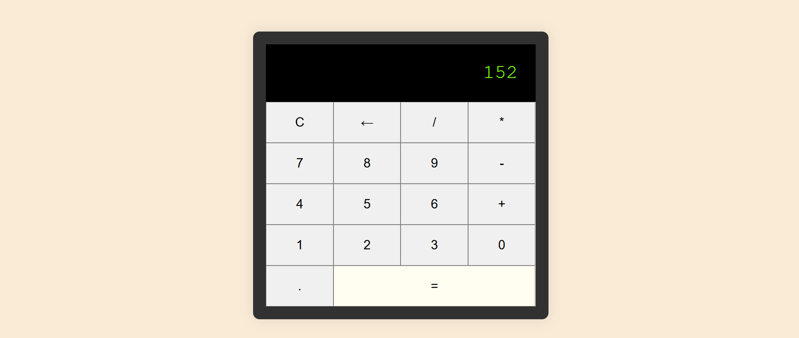

# 🧮 Calculadora Web Interactiva

Una aplicación de calculadora web funcional, moderna y responsiva construida con HTML5, CSS3 y JavaScript.

[](https://coddy.tech)


---

## 📝 Sobre este proyecto
Este código fue creado como un ejercicio de práctica dentro del curso de **Coddy**.

* **Plataforma:** [Coddy.tech](https://coddy.tech)
* **Objetivo:** Practicar lógica de programación y desarrollo de software.

---

## 📋 Características

* Diseño limpio y moderno: Interfaz basada en cuadrícula (CSS Grid) para una correcta alineación de los botones.
* Entrada dinámica: Muestra números y operadores matemáticos en tiempo real.
* Control de borrado individual: Botón de retroceso (←) para eliminar el último dígito ingresado.
* Borrado completo: Botón de limpieza (C) para restablecer la pantalla.
* Evaluación de operaciones: Realiza cálculos matemáticos de manera instantánea al presionar el botón de igual (=).
* Manejo de errores: Muestra un mensaje claro de Error en caso de ingresar una expresión sintácticamente inválida.

---

## 🛠️ Tecnologías Utilizadas

* HTML5: Estructura semántica de la aplicación.
* CSS3: Estilizado mediante CSS Grid, Flexbox y estados interactivos (:hover).
* JavaScript (ES6+): Lógica de manipulación del DOM y procesamiento de operaciones matemáticas.
* Google Fonts: Integración de tipografías personalizadas para mejorar la estética visual.

---

## 📁 Estructura del Proyecto

```text
.
├── index.html   # Estructura del maquetado HTML y vinculación de eventos
├── styles.css   # Hojas de estilo y reglas de diseño responsivo
└── script.js    # Funciones y lógica de la calculadora
```

---

## ⚙️ Funciones Principales (script.js)

<table>
  <tr>
    <th>Función</th>
    <th>Descripción</th>
  </tr>
  <tr>
    <td>appendToDisplay()</td>
    <td>Añade números o símbolos matemáticos a la pantalla (#display)</td>
  </tr>
  <tr>
    <td>clearDisplay()</td>
    <td>Vacía completamente el contenido de la pantalla</td>
  </tr>
  <tr>
    <td>deleteLast()</td>
    <td>Elimina el último carácter ingresado utilizando el método .slice()</td>
  </tr>
  <tr>
    <td>calculaResult()</td>
    <td>Evalúa la expresión matemática ingresada y muestra el resultado final</td>
  </tr>
</table>

---

## 🚀 Cómo Ejecutar el Proyecto

Clonar el repositorio:

```text
git clone https://github.com/Maicol843/Calculadora_Coddy.git
```

Acceder al directorio:

```text
cd Calculadora_Coddy
```

Abrir en el navegador:

```text
Haz doble clic en el archivo index.html.
```

O utiliza la extensión Live Server en Visual Studio Code para desplegarlo localmente.

---

<p align="center">
  
</p>

---

✨ Proyecto desarrollado como práctica de maquetación web, animaciones CSS y funciones JavaScript.
<p align="left">
  
  <b>Proyecto de Práctica | Realizado en <a href="https://coddy.tech/journeys/html/bottom_navigation_bar__htmlcss_project">Coddy</a></b>
</p>
